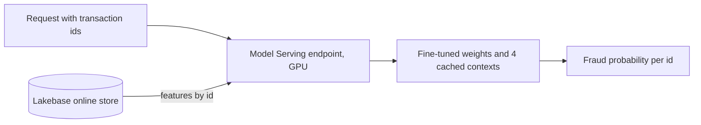

# Fine-tune and serve a tabular foundation model on Databricks

This repo scores card transactions for fraud with NVIDIA Kumo-Tabular. It fine-tunes the model on Databricks
AI Runtime, serves it on a GPU Model Serving endpoint, and reads features from a Lakebase online store.

Kumo-Tabular is an in-context model. You give it labelled rows, called the context, together with the rows you
want scored. It predicts from the context without a training step. This repo shows what changes its accuracy
on a large, imbalanced table, and how to serve it when a request is limited to 16 MB.

## What is in the repo

- Six notebooks that you run in order. They set up the volume, build the feature table, fine-tune the model,
  evaluate it, deploy the endpoint, and run three scoring scenarios.
- A fine-tuning loop in plain PyTorch. The fine-tuning and evaluation notebooks run on one GPU, either
  interactively or as a job.
- A served model that keeps its context inside the model artifact, so a request carries only a transaction id.
- A LightGBM baseline on the same split, as one step of the evaluation notebook.

## The data

The data is the Kaggle competition [Playground Series S6E11](https://www.kaggle.com/competitions/playground-series-s6e11).
The training file has 699,960 card transactions with 24 features. 1.67% of them are fraud. The data is not
in this repo. Download `train.csv` and `test.csv` from Kaggle.

The code splits the training file into train (80%), validation (10%) and test (10%). Contexts and fine-tuning
use the train part. The validation part picks the fine-tuning checkpoint. The numbers below are from the test
part, which has 69,996 transactions and 1,169 frauds.

## Results

| Model | Context | ROC-AUC | PR-AUC | Log-loss |
|---|---|---|---|---|
| Kumo-Tabular, as released | 8 random contexts of 1,024 rows | 0.9274 | 0.412 | 0.0540 |
| Kumo-Tabular, as released | 1 context of 1,024 rows, 30% fraud | 0.9388 | 0.463 | 0.0487 |
| Kumo-Tabular, as released | 8 contexts of 1,024 rows, 30% fraud | 0.9433 | 0.484 | 0.0474 |
| Kumo-Tabular, as released | 8 contexts of 8,192 rows, 30% fraud | 0.9455 | 0.496 | 0.0464 |
| Kumo-Tabular, fine-tuned | 1 context of 1,024 rows, 30% fraud | 0.9458 | 0.495 | 0.0467 |
| Kumo-Tabular, fine-tuned | 8 contexts of 1,024 rows, 30% fraud | 0.9467 | 0.498 | 0.0463 |
| Kumo-Tabular, fine-tuned | 8 contexts of 8,192 rows, 30% fraud | 0.9467 | 0.501 | 0.0461 |
| LightGBM | trained on the whole train part | 0.9466 | 0.499 | 0.0462 |

The model is the small Kumo-Tabular checkpoint with 27.5 million parameters. LightGBM used fixed settings and
early stopping. It was not tuned further.

Three things changed the accuracy.

1. Put more fraud in the context. A random context of 1,024 rows holds about 17 frauds, which is too few to
   learn from. A context with 30% fraud raised ROC-AUC from 0.927 to 0.943 at the same size. Such a context
   holds 18 times more fraud than the data, so the raw scores are too high. The code corrects the odds so
   that the scores match the true fraud rate.
2. Fine-tune the model. Fine-tuning for 2,000 steps raised ROC-AUC by 0.001 to 0.007. One fine-tuned context of 1,024
   rows scores the same as 64 times more context on the released model.
3. Use more context. The gain is small once the model is fine-tuned.

The fraud share has a wide useful range. This table is for the released model with 8 contexts of 1,024 rows on
the validation part. Notebook `03_evaluate` produces it.

| Fraud share of the context | ROC-AUC | PR-AUC | Log-loss |
|---|---|---|---|
| 1.7%, as in the data | 0.9251 | 0.434 | 0.0529 |
| 5% | 0.9347 | 0.475 | 0.0499 |
| 20% | 0.9400 | 0.498 | 0.0472 |
| 30% | 0.9398 | 0.492 | 0.0474 |
| 50% | 0.9400 | 0.490 | 0.0474 |
| 80% | 0.9400 | 0.486 | 0.0477 |

The fine-tuned model and this LightGBM baseline score the same on our test part. Neither is a strong
competition entry, as the next section shows. The reasons to use the in-context model are different. You can
add newly confirmed frauds to the context without training, and one small cached context is enough to serve.

## Kaggle public leaderboard

We submitted four files on 11 November 2026. The leaderboard had 1,466 teams. The top score was 0.95369 and
the median was 0.94815. The fine-tuned file came from an earlier fine-tuning run than the one in the results
table. The two runs score within 0.001 of each other on our test part.

| Submission | Context | Public ROC-AUC |
|---|---|---|
| Kumo-Tabular, fine-tuned | 8 contexts of 8,192 rows, 30% fraud | 0.94528 |
| Kumo-Tabular, as released | 8 contexts of 8,192 rows, 30% fraud | 0.94528 |
| LightGBM baseline | trained on the train part | 0.94501 |
| Kumo-Tabular, as released, with a search over contexts | 8 contexts of 1,024 rows | 0.94312 |

- All four scores are below the leaderboard median. The models used 80% of the training file, fixed settings
  and no feature engineering.
- Fine-tuning did not change the score at this context size. On our test part the gain at this size was
  0.001. The gain was larger with one small context, which is the case that helps serving.
- Kumo-Tabular scored 0.0003 above the LightGBM baseline.
- The last row uses 8 times fewer context rows than the other Kumo rows, so it is not a like-for-like
  comparison.

## A search over contexts

We also tried to find good contexts by search. The search keeps many candidate contexts of 1,024 rows. It
changes a candidate by adding rows that are close to transactions the candidate scores badly, and it keeps the
candidates that score best on some group of transactions. At the end it picks 8 contexts and their weights.
The idea comes from the GEPA optimizer. No language model is involved. The code for this experiment is not in
this repo.

Log-loss on 9,987 held-out transactions, mean of 3 runs, lower is better:

| Method, 8 contexts of 1,024 rows | Random rows | Rows with extra fraud, corrected |
|---|---|---|
| 8 random contexts, averaged | 0.0515 | 0.0440 |
| Pick the best 8 of 1,500 random contexts | 0.0461 | 0.0436 |
| Search, then pick the best 8 of 1,500 | 0.0451 | 0.0434 |

- With random rows, the search beat picking from random contexts by 0.0010. The 95% interval was 0.0001 to
  0.0019. The search found the same lever on its own. Its best contexts held 5% to 7% fraud, against 1.7%
  in the data.
- The search stopped there. It had no correction for the extra fraud, so more fraud made its scores too high.
- The plain rule of 30% fraud with the correction did better than the search, with no search at all.
- On top of that rule, the search gave no further gain. The difference was 0.0002, and the interval included
  zero.

We then gave the search a move that changes the fraud share of a context, with the matching correction. The
comparison method got the same choice. It draws random contexts at random fraud shares and picks the best 8.

| Method, 8 contexts of 1,024 rows | Log-loss |
|---|---|
| 8 random contexts at the best fixed fraud share, averaged | 0.0438 |
| Pick the best 8 of 1,500 random contexts at random fraud shares | 0.0433 |
| Search with the fraud share move, then pick the best 8 of 1,500 | 0.0436 |

- The new move improved the search by 0.0015. The comparison method improved by the same amount, and the
  search no longer beat it.
- The earlier win of the search came from fraud share, which the comparison method could not change at that
  point.
- A fixed fraud share between 26% and 49% gave about the same score. Below 20% and above 80% it was worse.

For this model and this data, the useful finding is the fraud share and its correction. A search is not
needed to use it.

## How the fine-tuning works

Each step draws a context and a separate batch of rows to predict. Both come from the train part, and both
hold 30% fraud. The loss is cross-entropy on the batch. The model assumes that the context and the rows to
predict come from one distribution, so both are sampled the same way. The correction for the extra fraud is
applied only when scoring.

- One step takes 0.26 seconds on an A10 GPU, with contexts of 512 to 2,048 rows and 1,024 rows to predict.
- In a run of 5,000 steps, validation ROC-AUC rose until about step 1,750 and fell after step 2,500. The
  train part has about 9,350 frauds and every step reuses many of them. The notebook stops at 2,000 steps and
  keeps the checkpoint with the best validation score, which was step 1,250 in our run.
- A model fine-tuned on contexts with 30% fraud does worse on random contexts than the released model. Serve
  it with the same kind of context it was tuned on.

## How the serving works

- The contexts are saved inside the model artifact. The endpoint fits them once when it starts and keeps the
  result on the GPU.
- A request carries only transaction ids. The endpoint looks up the 24 features in the Lakebase online store.
  A request is 39 bytes per id.
- A request can also carry the features. The endpoint then uses them and skips the lookup. Batch scoring uses
  this for transactions that are not in the feature table yet.

Measured on a GPU_SMALL endpoint (one T4):

| Scenario | What happens | Measured |
|---|---|---|
| Real time | One id per request, features from Lakebase | p50 269 ms, p95 309 ms, p99 326 ms |
| Batch upload | A CSV lands in a volume and is scored through the same endpoint in chunks | 2,000 rows per request, 1.36 MB per request |
| Context refresh | Newly confirmed frauds go into the context, a new model version is deployed, no training | Scores of the 8 frauds shown rose by 0.01 to 0.07 |

The latency was measured from a serverless notebook in the same region. Scores from a request with ids only
and from a request with full rows agreed to within 4e-8.

## Run it

You need the Databricks CLI and a workspace with these features:

- AI Runtime
- GPU Model Serving
- Lakebase

Clone this repo as a Git folder in the workspace and run the notebooks in order. Each notebook takes its
settings as widgets. Replace the `<catalog>` and `<schema>` placeholders with your own names.

| Notebook | Compute | What it does |
|---|---|---|
| `00_setup` | Serverless | Creates the schema and the volume, and downloads the model checkpoint |
| `01_features_and_online_store` | Serverless | Writes the feature table and publishes it to Lakebase |
| `02_finetune` | AI Runtime, one GPU | Fine-tunes the model and saves the best weights |
| `03_evaluate` | AI Runtime, one GPU | Scores the test part, adds the LightGBM row, writes a Kaggle file |
| `04_register_and_serve` | Serverless | Logs the model and creates the endpoint |
| `05_scoring_scenarios` | Serverless | Runs the three scoring scenarios |

1. Run `00_setup`. It downloads the small Kumo-Tabular checkpoint from the Hugging Face repo
   `nvidia/Kumo-Tabular`, revision `v1.0.1`, file `small/classifier.pt`, to
   `<volume>/checkpoints/kumo-tabular-v1.0.1/small/classifier.pt`. The Kaggle data needs one manual step,
   because Kaggle asks you to accept the competition rules first. The notebook stops and tells you to download
   `train.csv` and `test.csv` from Kaggle and upload them to `<volume>/raw/s6e11/`. Run it again after the
   upload.
2. Run `01_features_and_online_store`.
3. Run `02_finetune`. It takes about 15 minutes on one GPU and writes `finetuned.pt` and `summary.json` to
   `<volume>/runs/finetune/`.
4. Run `03_evaluate`. It writes the test table, the fraud share comparison and `submission.csv` to
   `<volume>/runs/evaluate/`.
5. Run `04_register_and_serve`. Set the `weights` field to the path of `finetuned.pt`. The first deployment
   takes about 20 minutes.
6. Run `05_scoring_scenarios`.

The two GPU notebooks can also run headless. Replace the placeholders in `jobs/finetune.yaml` and
`jobs/evaluate.yaml`, then run `databricks air run --file jobs/finetune.yaml` and
`databricks air run --file jobs/evaluate.yaml`. A job runs the notebook file as a plain Python script. Each
variable in the job file sets the notebook parameter of the same name. On a laptop you can run
`python notebooks/02_finetune.py` the same way, with the parameters set as environment variables.

The serverless notebooks do not need a GPU or the model library, because the endpoint loads the model.

## Layout

| Path | Content |
|---|---|
| `notebooks/` | The six notebooks, in run order from `00_setup` to `05_scoring_scenarios` |
| `jobs/` | Job files that run the fine-tuning and evaluation notebooks headless on AI Runtime |
| `src/kumo_fraud/data.py` | Load the CSV files and split them |
| `src/kumo_fraud/context.py` | Build contexts with extra fraud and correct the scores |
| `src/kumo_fraud/scorer.py` | Load the model and score rows against contexts |
| `src/kumo_fraud/finetune.py` | The fine-tuning loop |
| `src/kumo_fraud/serving.py` | The served model |
| `src/kumo_fraud/workspace.py` | Notebook parameters, feature tables, model logging, endpoint calls, chunked scoring |
| `tests/` | Unit tests, and a short run of the two GPU notebooks on CPU. The model tests and the notebook run need the checkpoint and the data on disk |

## Limits

- The data is synthetic. The ranking of methods may differ on real transactions.
- The transactions have no customer or card key, so the feature lookup is by transaction id.
- The context refresh raised the scores of the added frauds by a small amount. It does not replace training
  when fraud patterns change a lot.
- An endpoint with scale to zero takes several minutes to start after it has been idle.
