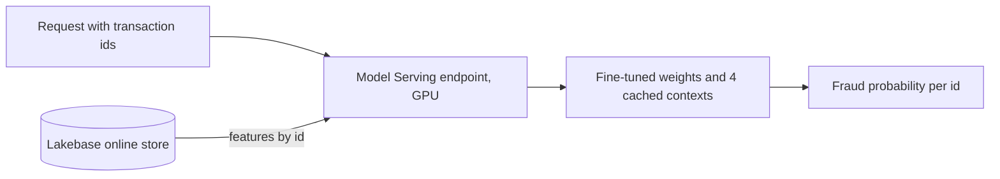

# Fine-tune and serve a tabular foundation model on Databricks

This repo scores card transactions for fraud with NVIDIA Kumo-Tabular. It fine-tunes the model on Databricks
AI Runtime, serves it on a GPU Model Serving endpoint, and reads features from a Lakebase online store.

Kumo-Tabular is an in-context model. You give it labelled rows, called the context, together with the rows you
want scored. It predicts from the context without a training step. This repo shows what changes its accuracy
on a large, imbalanced table, and how to serve it when a request is limited to 16 MB.

## What is in the repo

- A fine-tuning loop in plain PyTorch, and a job file to run it on one GPU.
- A served model that keeps its context inside the model artifact, so a request carries only a transaction id.
- Three notebooks that build the feature table, deploy the endpoint, and run three scoring scenarios.
- A LightGBM baseline on the same split.

## The data

The data is the Kaggle competition [Playground Series S6E11](https://www.kaggle.com/competitions/playground-series-s6e11).
The training file has 699,960 card transactions with 24 features. 1.67% of them are fraud. The data is not
in this repo. Download `train.csv` and `test.csv` from Kaggle.

The code splits the training file into train (80%), validation (10%) and test (10%). Contexts and fine-tuning
use the train part. The validation part picks the fine-tuning checkpoint. The numbers below are from the test
part, which has 69,996 transactions and 1,169 frauds.

## Results

| Model | Context | ROC-AUC | PR-AUC | Log-loss |
|---|---|---|---|---|
| Kumo-Tabular, as released | 8 random contexts of 1,024 rows | 0.9274 | 0.412 | 0.0540 |
| Kumo-Tabular, as released | 1 context of 1,024 rows, 30% fraud | 0.9388 | 0.463 | 0.0487 |
| Kumo-Tabular, as released | 8 contexts of 1,024 rows, 30% fraud | 0.9433 | 0.484 | 0.0474 |
| Kumo-Tabular, as released | 8 contexts of 8,192 rows, 30% fraud | 0.9455 | 0.496 | 0.0464 |
| Kumo-Tabular, fine-tuned | 1 context of 1,024 rows, 30% fraud | 0.9454 | 0.492 | 0.0466 |
| Kumo-Tabular, fine-tuned | 8 contexts of 1,024 rows, 30% fraud | 0.9463 | 0.496 | 0.0463 |
| Kumo-Tabular, fine-tuned | 8 contexts of 8,192 rows, 30% fraud | 0.9466 | 0.498 | 0.0463 |
| LightGBM | trained on the whole train part | 0.9466 | 0.499 | 0.0462 |

The model is the small Kumo-Tabular checkpoint with 27.5 million parameters. LightGBM used fixed settings and
early stopping. It was not tuned further.

Three things changed the accuracy.

1. Put more fraud in the context. A random context of 1,024 rows holds about 17 frauds, which is too few to
   learn from. A context with 30% fraud raised ROC-AUC from 0.927 to 0.943 at the same size. Such a context
   holds 18 times more fraud than the data, so the raw scores are too high. The code corrects the odds so
   that the scores match the true fraud rate.
2. Fine-tune the model. About 1,750 steps raised ROC-AUC by 0.001 to 0.007. One fine-tuned context of 1,024
   rows scores the same as 64 times more context on the released model.
3. Use more context. The gain is small once the model is fine-tuned.

The fine-tuned model and LightGBM score the same on this data. The reasons to use the in-context model are
different. You can add newly confirmed frauds to the context without training, and one small cached context
is enough to serve.

## How the fine-tuning works

Each step draws a context and a separate batch of rows to predict. Both come from the train part, and both
hold 30% fraud. The loss is cross-entropy on the batch. The model assumes that the context and the rows to
predict come from one distribution, so both are sampled the same way. The correction for the extra fraud is
applied only when scoring.

- One step takes 0.26 seconds on an A10 GPU, with contexts of 512 to 2,048 rows and 1,024 rows to predict.
- Validation ROC-AUC rose until about step 1,750 and fell after step 2,500. The train part has about 9,350
  frauds and every step reuses many of them. The job keeps the checkpoint with the best validation score.
- A model fine-tuned on contexts with 30% fraud does worse on random contexts than the released model. Serve
  it with the same kind of context it was tuned on.

## How the serving works

- The contexts are saved inside the model artifact. The endpoint fits them once when it starts and keeps the
  result on the GPU.
- A request carries only transaction ids. The endpoint looks up the 24 features in the Lakebase online store.
  A request is 39 bytes per id.
- A request can also carry the features. The endpoint then uses them and skips the lookup. Batch scoring uses
  this for transactions that are not in the feature table yet.

Measured on a GPU_SMALL endpoint (one T4):

| Scenario | What happens | Measured |
|---|---|---|
| Real time | One id per request, features from Lakebase | p50 269 ms, p95 309 ms, p99 326 ms |
| Batch upload | A CSV lands in a volume and is scored through the same endpoint in chunks | 2,000 rows per request, 1.36 MB per request |
| Context refresh | Newly confirmed frauds go into the context, a new model version is deployed, no training | Scores of the 8 frauds shown rose by 0.01 to 0.07 |

The latency was measured from a serverless notebook in the same region. Scores from a request with ids only
and from a request with full rows agreed to within 4e-8.

## Run it

You need the Databricks CLI and a workspace with these features:

- AI Runtime
- GPU Model Serving
- Lakebase

1. Download `train.csv` and `test.csv` from Kaggle. Upload them to `<volume>/raw/s6e11/`.
2. Download the small Kumo-Tabular checkpoint from the Hugging Face repo `nvidia/Kumo-Tabular`, revision
   `v1.0.1`, file `small/classifier.pt`. Upload it to
   `<volume>/checkpoints/kumo-tabular-v1.0.1/small/classifier.pt`.
3. Fine-tune. Replace the placeholders in `jobs/finetune.yaml`, then run
   `databricks air run --file jobs/finetune.yaml`. It takes about 15 minutes on one GPU.
4. Score the test part with `databricks air run --file jobs/evaluate.yaml`. This also writes a
   `submission.csv` for Kaggle.
5. Clone this repo as a Git folder in the workspace and run the notebooks in order.
   - `01_features_and_online_store` writes the feature table and publishes it to Lakebase.
   - `02_register_and_serve` logs the model and creates the endpoint. Set the `weights` field to the path of
     `finetuned.pt`. The first deployment takes about 20 minutes.
   - `03_scoring_scenarios` runs the three scenarios.
6. For the LightGBM numbers, run `PYTHONPATH=src python jobs/baseline_lightgbm.py <data_dir>` on a laptop.

The notebooks run on a serverless notebook. They do not need a GPU or the model library, because the endpoint
loads the model.

## Layout

| Path | Content |
|---|---|
| `src/kumo_fraud/data.py` | Load the CSV files and split them |
| `src/kumo_fraud/context.py` | Build contexts with extra fraud and correct the scores |
| `src/kumo_fraud/scorer.py` | Load the model and score rows against contexts |
| `src/kumo_fraud/finetune.py` | The fine-tuning loop |
| `src/kumo_fraud/serving.py` | The served model |
| `src/kumo_fraud/workspace.py` | Feature tables, model logging, endpoint calls, chunked scoring |
| `jobs/` | Fine-tuning and evaluation jobs for AI Runtime, and the LightGBM baseline |
| `notebooks/` | Feature setup, deployment, scoring scenarios |
| `tests/` | Unit tests. The model tests need the checkpoint and the data on disk |

## Limits

- The data is synthetic. The ranking of methods may differ on real transactions.
- The transactions have no customer or card key, so the feature lookup is by transaction id.
- The context refresh raised the scores of the added frauds by a small amount. It does not replace training
  when fraud patterns change a lot.
- An endpoint with scale to zero takes several minutes to start after it has been idle.
